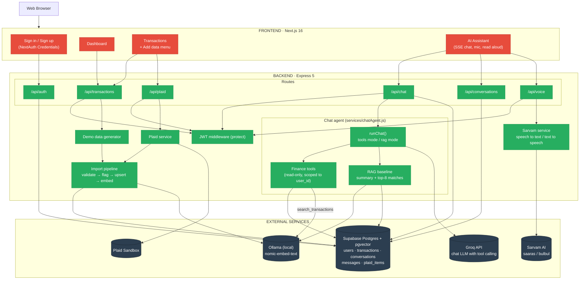
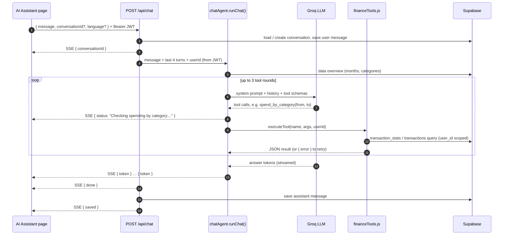
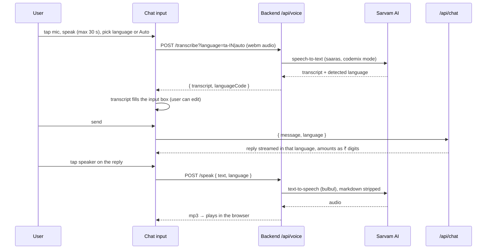
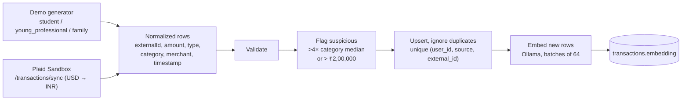

# 💰 RAG Finance Assistant

A full-stack personal finance web app with an AI assistant that answers questions about **your own transactions**. You can type or speak in English, Hindi, Tamil, Telugu, Kannada or Malayalam.

- **Accounts and data:** users sign up and sign in with the app's own **JWT auth**. Users, transactions, conversations, messages and vector embeddings all live in one **Supabase (Postgres + pgvector)** database.
- **Getting transactions in:** load a seeded **demo dataset** (student, young professional or family persona) or connect a bank through **Plaid Sandbox**. Every import goes through one pipeline that validates rows, flags suspicious ones, removes duplicates and embeds each row.
- **Embeddings:** every transaction is embedded into a **768-dimensional vector** with **nomic-embed-text** running locally on **Ollama**. The vector is stored on the transaction row itself (pgvector, HNSW index), so there is no separate vector database.
- **The assistant (tools mode, default):** the LLM on **Groq** (default `qwen/qwen3.8-27b`) calls **read-only tools**: totals, spend by category, top merchants, monthly totals, period comparisons, transaction lists and semantic search. The tools run real SQL over your data, so amounts and date ranges come from Postgres instead of being guessed by the model. The answer streams token by token over **Server-Sent Events (SSE)**.
- **RAG mode (baseline):** the original pipeline is still available with `CHAT_MODE=rag`, for comparison. It pastes a financial summary plus the top 8 semantic matches into the prompt.
- **Voice (optional):** **Sarvam AI** transcribes speech, including Tamil + English mixed speech. The reply comes back in the language you spoke, with ₹ digits, and can be read aloud.
- **Frontend:** **Next.js 16**, **React 19**, **TypeScript**, **Tailwind CSS v4** and **shadcn/ui**. It has a live dashboard, a transactions page and the chat with conversation history. Light and dark themes are included.

---

## 🏗️ Architecture



---

## 🧠 How the assistant answers

### Tools mode (default)

The model never sees your raw table. It decides which tool to call and with what date range. The server runs the tool against Postgres, always filtered by the signed-in user's id, and the model answers from the result.



| Tool | What it answers |
|---|---|
| `totals_for_range` | Total spent, received and net for a date range |
| `spend_by_category` | Spending per category, largest first |
| `top_merchants` | Merchants ranked by spend (optionally within a category) |
| `monthly_totals` | Month-by-month totals (IST calendar months) |
| `compare_periods` | Two periods side by side, overall or per category |
| `list_transactions` | Filtered, sorted transactions (newest, oldest, largest, suspicious only, …) |
| `search_transactions` | Semantic search over embeddings (e.g. "streaming services") |

Dates are IST calendar days, and `to` is inclusive. The prompt carries today's date, so "last month" and "this year" resolve to exact ranges.

### RAG mode (`CHAT_MODE=rag`, baseline)

```
User question
  ├── embedText(question) via Ollama → 768-dim vector
  ├── Supabase RPC match_transactions(): cosine similarity, scoped to user_id,
  │     min score 0.45 → top 8 transactions
  ├── buildFinancialSummary() over the latest 100 transactions
  │     → totals, category breakdown, merchants
  ├── Prompt = system rules + summary + matches + last 4 turns + question
  └── Groq streams the answer → SSE → frontend
```

It's kept so the two approaches can be compared with the eval script (see [Evaluating the chat](#-evaluating-the-chat)).

### Voice chat (optional, Sarvam AI)



- **Languages:** English, Hindi, Tamil, Telugu, Kannada and Malayalam.
- **Mixed speech:** `codemix` mode keeps English words like "food" or "Swiggy" in English letters inside Tamil or Hindi text, so the model can still match them to categories and merchants. For example: "last month food-ku evlo spend pannen?"
- **Disabled without a key:** without `SARVAM_API_KEY`, the mic and speaker buttons are hidden and everything else works as usual.

---

## 📥 Transaction imports



- **Re-imports are safe:** a row that already exists is skipped.
- **Embedding failures:** the inserted rows are kept, and the result reports `embedError`.
- **Backfill:** rows inserted by hand, or imported while Ollama was down, can be embedded later with `node src/scripts/ingest.js`. Rows without an embedding don't show up in semantic search.

---

## 📁 Folder Structure

```
rag-finance-assistant/
├── AGENTS.md / CLAUDE.md                 # Context for AI coding agents
├── PROJECT_SUMMARY.md                    # Earlier design write-up (predates Groq + tools, partly outdated)
│
├── backend-node/
│   ├── server.js                         # Express app, route registration
│   ├── eval/questions.json               # Chat eval set (incl. Hindi/Tamil/Malayalam questions)
│   └── src/
│       ├── config/
│       │   ├── supabase.js               # Supabase client (service_role key)
│       │   └── db.js                     # Legacy connectDB(), only logs
│       ├── controllers/
│       │   ├── authController.js         # Sign up / sign in, issues JWT
│       │   ├── chatController.js         # POST /api/chat, SSE stream
│       │   └── conversationController.js # Conversation CRUD
│       ├── middleware/authMiddleware.js  # protect: verifies Bearer JWT
│       ├── models/                       # Supabase data access (snake_case → camelCase + _id)
│       │   ├── User.js · Transactions.js · Conversations.js · PlaidItems.js
│       ├── routes/
│       │   ├── authRoutes.js · chatRoutes.js · conversationRoutes.js
│       │   ├── transactionRoutes.js      # list, demo import, delete by source
│       │   ├── plaidRoutes.js            # link token, exchange, sync, items
│       │   └── voiceRoutes.js            # config, transcribe, speak
│       ├── services/
│       │   ├── chatAgent.js              # runChat(): tools loop / rag baseline
│       │   ├── importTransactions.js     # Shared import pipeline
│       │   ├── demoData.js               # Seeded demo personas
│       │   ├── plaid.js                  # Plaid client, encrypted tokens, sync
│       │   └── sarvam.js                 # Sarvam speech to text / text to speech
│       ├── scripts/
│       │   ├── ingest.js                 # Embedding backfill
│       │   └── evalChat.js               # Runs eval/questions.json → eval/results.md
│       ├── supabase/schema.sql           # Tables, pgvector, RPCs, RLS (run in SQL editor)
│       └── utils/
│           ├── aiService.js              # Groq client, prompts, streamCompletion
│           ├── financeTools.js           # Tool schemas + handlers
│           ├── embedService.js           # Text → 768-dim vector (Ollama)
│           ├── ingestTransactions.js     # buildEmbeddingText (single embedding format)
│           ├── retrieveContext.js        # match_transactions RPC
│           └── financialSummary.js       # Summary for rag mode
│
└── frontend/
    ├── proxy.ts                          # Next.js 16 middleware: auth redirects + matcher
    ├── app/
    │   ├── (auth)/sign-in · sign-up      # Public pages
    │   ├── (root)/
    │   │   ├── layout.tsx                # Sidebar shell
    │   │   ├── dashboard/                # Balance, spending, savings, fraud alerts (live)
    │   │   ├── transactions/             # Transaction table + Add data menu (live)
    │   │   └── ai-assistant/             # SSE chat, voice, read aloud
    │   └── api/auth/[...nextauth]/       # NextAuth Credentials → backend sign-in
    ├── components/
    │   ├── assistant/                    # ChatInput, MessageList, MessageBubble, MarkdownContent, TypingIndicator
    │   ├── dashboard/                    # Dashboard cards + RangeSelect
    │   ├── transactions/AddDataMenu.tsx  # Demo data + Plaid Link
    │   ├── Sidebar.tsx · ChatHistory.tsx · PageShell.tsx · ThemeToggle.tsx
    │   └── ui/                           # shadcn/ui primitives
    ├── lib/
    │   ├── useTransactions.ts            # Shared transactions hook
    │   ├── dashboard.ts                  # INR formatters, range filters
    │   ├── voice.ts · useRecorder.ts     # Voice language picker, /api/voice calls, mic recorder
    │   └── api.ts                        # Stale, unused
    └── types/                            # chat.ts, transaction.ts, global.d.ts
```

---

## 🧰 Tech Stack

### Backend

| Technology | Purpose |
|---|---|
| **Node.js** (v18+) + **Express 5** | API server (plain JS, ES modules) |
| **@supabase/supabase-js** | Postgres + pgvector access |
| **groq-sdk** | Chat LLM with streaming tool calls |
| **axios** | Ollama embeddings API |
| **plaid** | Plaid Sandbox bank connection |
| **jsonwebtoken** + **bcryptjs** | JWT auth, password hashing |
| Native `fetch` / `FormData` | Sarvam AI speech APIs |

### Frontend

| Technology | Purpose |
|---|---|
| **Next.js 16** (App Router) + **React 19** + **TypeScript** | App framework |
| **Tailwind CSS v4** + **shadcn/ui** (Radix) | Styling and components, light/dark theme |
| **NextAuth v4** | Credentials sign-in holding the backend JWT |
| **Recharts** | Dashboard charts |
| **react-markdown** + **remark-gfm** | Rendering assistant replies |
| **react-plaid-link** | Plaid Link widget |
| **sonner** · **lucide-react** | Toasts, icons |

### External services

| Service | Used for | Required? |
|---|---|---|
| **Supabase** | Postgres + pgvector, all app data | Yes |
| **Groq** | Chat LLM (`GROQ_MODEL`, must support tool calling) | Yes |
| **Ollama** (local) | `nomic-embed-text` embeddings only | Yes (for embedding and semantic search) |
| **Plaid Sandbox** | Test bank connection | Optional |
| **Sarvam AI** | Voice: speech to text and text to speech in Indian languages | Optional |

---

## 📋 Prerequisites

### 1. Node.js v18+

```bash
node --version    # v18.x or higher (native fetch / FormData are used)
```

### 2. Supabase project

1. Create a project at https://supabase.com.
2. In the **SQL Editor**, run `backend-node/src/supabase/schema.sql`. It creates:
   - the tables (`users`, `transactions`, `conversations`, `messages`, `plaid_items`)
   - the `vector` extension and the HNSW index
   - the `match_transactions` and `transaction_stats` RPCs. Tools-mode chat fails without `transaction_stats`.
   - the RLS policies

   If your database predates the `source` / `external_id` columns, run the migration commented at the bottom of the file.
3. Under **Project Settings → API**, copy the Project URL into `SUPABASE_URL` and the **service_role** key into `SUPABASE_SERVICE_ROLE_KEY`.

> **Use the service_role key, not the anon key.** The app uses its own JWT, not Supabase Auth, so `auth.uid()` is always NULL. With the anon key, RLS would silently return zero rows. Because RLS is bypassed, every backend query filters by `user_id` itself.

There's no migration tooling. Schema changes are applied by hand in the SQL editor.

### 3. Ollama (embeddings only)

```bash
# https://ollama.com/download
ollama pull nomic-embed-text   # 768-dim embedding model
ollama list
```

The chat model runs on Groq, so you don't need a local LLM.

### 4. API keys

- **Groq:** https://console.groq.com/keys (required)
- **Plaid:** https://dashboard.plaid.com/developers/keys (optional, Sandbox keys)
- **Sarvam AI:** https://dashboard.sarvam.ai (optional, for voice)

---

## ⚙️ Environment Variables

### Backend: `backend-node/.env`

```env
# Server
PORT=5000

# Supabase (service_role key, see above)
SUPABASE_URL=https://<your-project>.supabase.co
SUPABASE_SERVICE_ROLE_KEY=your_supabase_service_role_key

# JWT secret (long random string)
JWT_SECRET=your_jwt_secret

# Ollama (embeddings)
OLLAMA_URL=http://localhost:11434

# Groq (chat LLM)
GROQ_API_KEY=your_groq_api_key
# GROQ_MODEL=qwen/qwen3.8-27b     # optional, must support tool calling
# CHAT_MODE=tools                  # optional: tools (default) | rag (baseline)

# Plaid Sandbox (optional, enables "Connect bank")
PLAID_CLIENT_ID=your_plaid_client_id
PLAID_SECRET=your_plaid_sandbox_secret
PLAID_ENV=sandbox
# 32-byte hex key that encrypts stored Plaid access tokens (AES-256-GCM):
#   node -e "console.log(require('crypto').randomBytes(32).toString('hex'))"
PLAID_TOKEN_KEY=64_hex_chars
USD_TO_INR=83                      # Plaid sandbox amounts are USD

# Sarvam AI voice (optional, enables the mic and read aloud)
SARVAM_API_KEY=your_sarvam_api_key
# SARVAM_STT_MODEL=saaras:v3
# SARVAM_STT_MODE=codemix          # or: transcribe
# SARVAM_TTS_MODEL=bulbul:v3
# SARVAM_TTS_SPEAKER=shubh         # must be valid for the TTS model
```

If the Plaid variables are missing, `/api/plaid/*` returns 503 and the bank actions are hidden. If `SARVAM_API_KEY` is missing, the voice buttons are hidden. Restart the backend after editing `.env`.

### Frontend: `frontend/.env`

```env
NEXT_PUBLIC_BACKEND_URL=http://localhost:5000
NEXTAUTH_URL=http://localhost:3000
NEXTAUTH_SECRET=your_nextauth_secret
```

---

## 🚀 Getting Started

```bash
# Terminal 1: Ollama
ollama serve

# Terminal 2: backend
cd backend-node
npm install
npm run dev            # nodemon on PORT (5000)

# Terminal 3: frontend
cd frontend
npm install
npm run dev            # http://localhost:3000
```

Then:

1. **Sign up** at `/sign-up` and **sign in**.
2. Open **Transactions → Add data**:
   - **Load demo data:** 6 months of realistic INR transactions for a student, young professional or family persona, including a few deliberately suspicious ones.
   - **Connect bank:** Plaid Link in Sandbox mode. Log in with `user_transactions_dynamic` and any password.

   Imported rows are embedded right away.
3. Check the **Dashboard**, then ask the **AI Assistant** things like "How much did I spend on food last month?" or "Compare my spending with the month before". With Sarvam configured, tap the mic and ask in your language.

---

## 🧪 Evaluating the chat

There is no unit test suite. The chat eval runs `backend-node/eval/questions.json` against a user who has **young_professional** demo data. For each question it calls the tools directly to get the ground truth, then checks that the right numbers and names appear in the answer:

```bash
cd backend-node
node src/scripts/evalChat.js --email you@example.com [--modes rag,tools] [--only 1,4,21]
# → writes eval/results.md
```

Questions with a `language` field (Hindi, Tamil, Tamil + English, Malayalam) are sent the same way voice input is.

---

## 🖥️ Commands Reference

| Action | Command | Directory |
|---|---|---|
| Start backend (dev) | `npm run dev` | `backend-node/` |
| Embedding backfill | `node src/scripts/ingest.js` | `backend-node/` |
| Chat eval | `node src/scripts/evalChat.js --email <user>` | `backend-node/` |
| Start frontend (dev) | `npm run dev` | `frontend/` |
| Build / start frontend | `npm run build` / `npm run start` | `frontend/` |
| Lint frontend | `npm run lint` | `frontend/` |
| Start Ollama | `ollama serve` | anywhere |
| Pull embedding model | `ollama pull nomic-embed-text` | anywhere |

Optional Ollama tip: set `OLLAMA_KEEP_ALIVE=-1` before `ollama serve` so the embedding model stays loaded between requests.

---

## 📡 API Endpoints

| Method | Endpoint | Auth | Description |
|---|---|---|---|
| `POST` | `/api/auth/signup` | none | Register a new user |
| `POST` | `/api/auth/signin` | none | Sign in, returns a JWT |
| `POST` | `/api/chat` | JWT | Chat turn, SSE stream: `{conversationId}` → `{status}`* → `{token}`* → `{done}` → `{saved}` (`{error}` on failure). Body: `{ message, conversationId?, language? }` |
| `GET` | `/api/conversations?userId=` | ⚠️ none | List a user's conversations |
| `GET` | `/api/conversations/:id?userId=` | ⚠️ none | One conversation with its messages |
| `POST` | `/api/conversations` | ⚠️ none | Create a conversation |
| `POST` | `/api/conversations/:id/messages` | ⚠️ none | Append a message |
| `PATCH` | `/api/conversations/:id/title` | ⚠️ none | Rename a conversation |
| `DELETE` | `/api/conversations/:id` | ⚠️ none | Delete a conversation (messages cascade) |
| `GET` | `/api/transactions` | JWT | Latest 100 transactions, newest first |
| `POST` | `/api/transactions/demo` | JWT | Generate and import demo data `{ persona, months }` |
| `DELETE` | `/api/transactions?source=demo\|plaid` | JWT | Remove one source's data (`plaid` also unlinks banks) |
| `GET` | `/api/plaid/items` | JWT | Linked sandbox banks |
| `POST` | `/api/plaid/link-token` | JWT | Token for Plaid Link |
| `POST` | `/api/plaid/exchange` | JWT | Exchange the public token, store the item, import |
| `POST` | `/api/plaid/sync` | JWT | Pull new transactions for every linked bank |
| `GET` | `/api/voice/config` | JWT | `{ enabled, languages }` |
| `POST` | `/api/voice/transcribe?language=<code\|auto>` | JWT | Raw audio body (≤5 MB) → `{ transcript, languageCode }` |
| `POST` | `/api/voice/speak` | JWT | `{ text, language }` → `audio/mpeg` |

---

## 🔒 Security and Limitations

### Security
- **JWT auth:** chat, transactions, Plaid and voice routes require `Authorization: Bearer <token>`. The chat tools read the user id from the verified token, never from the request body or the model.
- **Passwords** are hashed with bcrypt.
- **Service role key (backend only):** it bypasses RLS, so every query filters by `user_id` explicitly. Never expose this key to the frontend.
- **RLS policies** exist in the schema for a possible future move to Supabase Auth, but the service role key bypasses them today.
- **Plaid access tokens** are stored encrypted with AES-256-GCM (`PLAID_TOKEN_KEY`).
- **Secrets** live in `.env` files, which must never be committed.

### Known limitations
- **`/api/conversations/*` is not protected.** It trusts a `userId` from the query or body. Putting it behind `protect` is the main open security fix.
- **CORS is open.** `cors()` runs with defaults and accepts any origin. Restrict it before deploying.
- **Plaid sync** only applies `added` transactions. `modified` and `removed` are still a TODO.
- **The Transactions page and dashboard** load the latest 100 transactions. The assistant's tools see the full history.
- **Voice quality** depends on Sarvam. Malayalam and Kannada are the least tested, and recordings are capped at 30 seconds.
- **Missing pages:** `fraud-detection` and `app-settings` are listed in the route matcher but have no pages yet.
- **No role-based access** or admin panel.

---

## 🤝 Contributions

1. Fork the repository
2. Create a feature branch (`git checkout -b feature/your-feature`)
3. Commit your changes
4. Push and open a Pull Request

See [AGENTS.md](AGENTS.md) for architecture notes and conventions. For major changes, open an issue first.

---

## 📄 License

This project is for educational and personal use.
